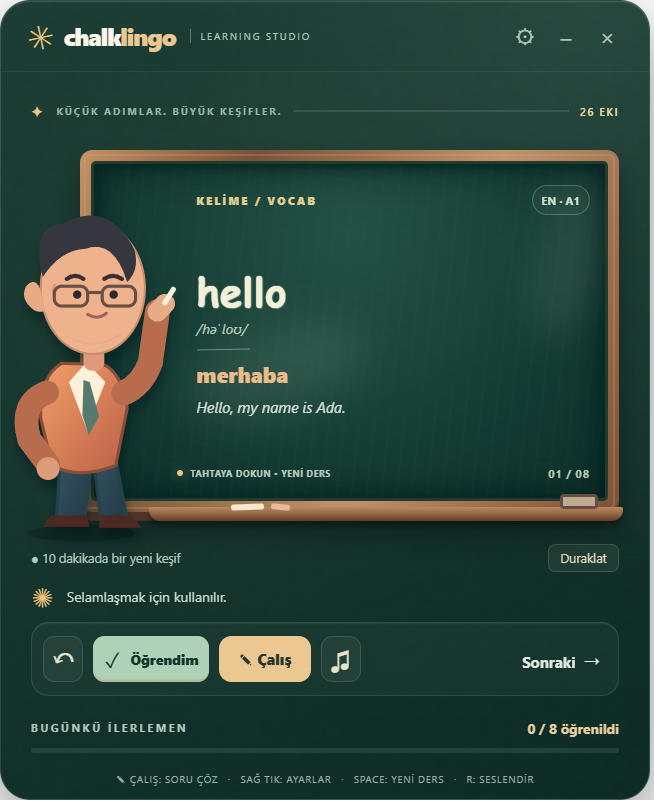
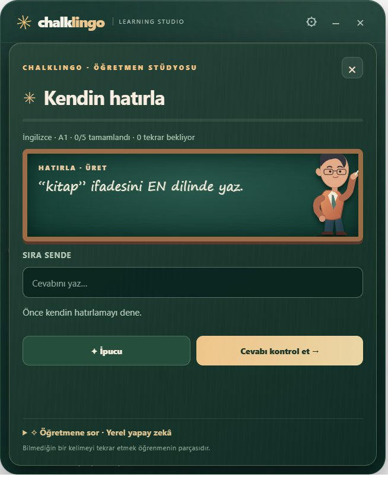
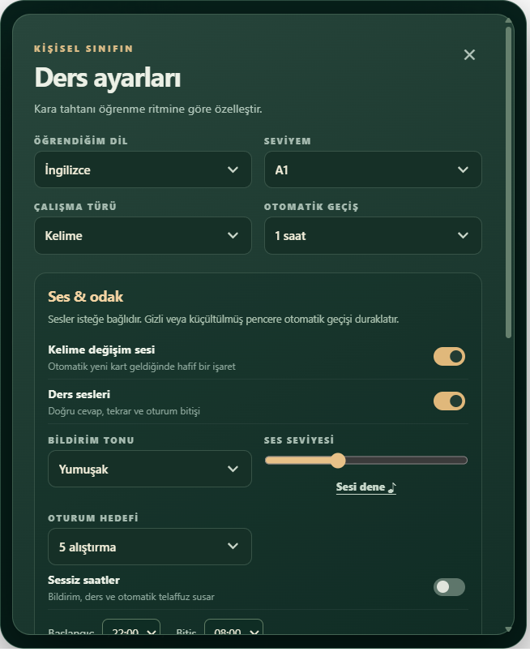
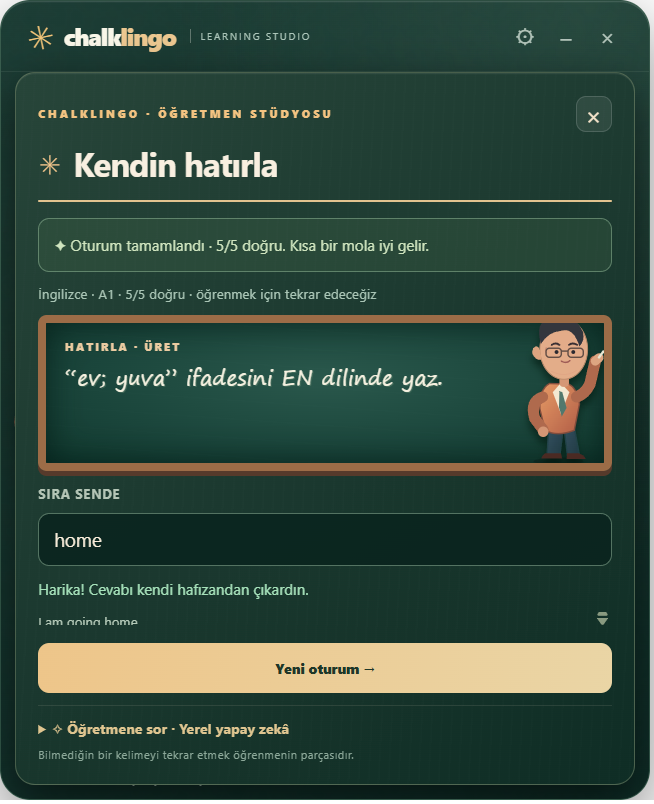

# ChalkLingo · Learning Studio 0.3.0

Masaüstünde küçük bir sınıf, sana uygun bir öğrenme ritmi.



## 0.3.0 yenilikleri

- Yenilenen 520 × 640 sınıf, daha okunaklı tahta; nefes, göz kırpma, baş eğme, yazma ve telaffuza eşlik eden ağız hareketleri. Karakter hafif SVG çizimidir; fotogerçekçi 3D avatar değildir.
- Otomatik geçiş: kapalı, 30 saniye, 1/2/5/10/15/30 dakika, 1/2 saat. Duraklat/devam et kalan süreyi korur.
- Kelime değişim sesi, ders efektleri ve otomatik telaffuz bağımsız tercihlerdir; başlangıçta kapalıdır. Üç ton, ses seviyesi, önizleme ve geceyi aşabilen sessiz saatler bulunur.
- 5/10/15 alıştırmalık oturum hedefleri, ilerleme çizgisi ve bitiş özeti. Mevcut 212 kart ve aralıklı tekrar sistemi korunur; bu bir tam CEFR müfredatı değildir.
- Ayarlar/alıştırma açıkken veya pencere gizli/küçültülmüşken otomatik geçiş durur. Geri dönünce birikmiş bildirimler çalmaz. Gizli animasyonlar durur; azaltılmış hareket ve işletim sistemi tercihi desteklenir.
- Tek uygulama örneği, toplu konum kaydı, tek zamanlayıcı, kullanılan ses düğümlerinin temizlenmesi ve boşta ses motorunun askıya alınması.
- Daha sıkı ana frame/URL IPC doğrulaması; tek eşzamanlı yerel model isteği; yanıt akarken uygulanan gerçek 160 KB sınırı. Model için 2 CPU iş parçacığı, 2.048 bağlam, 280 çıktı token ve yanıt sonrası bellekten çıkma talebi.

| Ders stüdyosu | Ses ve zamanlama |
| --- | --- |
|  |  |



Ekran görüntüleri gerçek Windows/Electron penceresinden alınmıştır.

### Tercihler nasıl çalışır?

⚙ veya sağ tık → dili, ritmi, sesleri ve hedefi seç → **Tahtaya dön** ile kaydet. Uzun ayar paneli kaydırılabilir. Sessiz saatlerde otomatik sesler susar, kartlar ilerleyebilir. Başlangıç ve bitiş aynıysa gün boyu sessizdir. **Sesi dene** ve elle telaffuz düğmesi bilinçli eylemler olduğundan sessiz saatlerde de çalışır.

Ses uygulama içindeki **otomatik kart değişiminde** çalar; Windows bildirim merkezi mesajı gönderilmez. Küçültülmüş uygulama arkadan kelime veya ses göndermez. Telaffuz sistem seslerine bağlıdır; bazı sesler ağ kullanabilir. Oturum hedefi desteden büyükse kartlar tekrar edilir. Windows'ta kapat düğmesi çıkar; küçültme görev çubuğuna indirir. Otomatik başlangıç veya sistem ayarı değişikliği yapılmaz.

### Doğrulama

26 Ekim 2026: **24 test**, gerçek Electron arayüz testi ve npm bağımlılık taraması geçti; tarama bilinen açık bildirmedi. Kısa geliştirme ölçümünde animasyonlu açık pencere toplam yaklaşık **%1,56 CPU**, küçültülmüş pencere **%0,10 CPU** gösterdi. Süreç çalışma kümelerinin toplamı yaklaşık **512 MiB** idi; paylaşılan bellek çift sayılabilir. Bu bir stres testi veya her cihazda donmama garantisi değildir. Ollama kaynak tüketimi ayrıca artabilir; istek seçenekleri işletim sistemi kotası değildir.

Windows yükleyici ve portable paketleri üretildi; **imzasızdır**. Temiz fiziksel cihazda kurulum/kaldırma, uzun süreli kullanım, bütün dillerin ses kalitesi ve gerçek Ollama modeli ayrıca test edilmelidir. [Doğrulama raporu](docs/VALIDATION.md).

Masaüstü regresyon testi: **npm run test:desktop**. Test görünür pencere açar; çalışırken pencereyle etkileşmeyin. Kişisel veri yerine ayrı profil kullanır; rapor ve görüntüler Git dışında tutulan **.qa/** klasörüne yazılır. README görüntülerini yenilemek için PowerShell ortam değişkeni **CHALK_SCREENSHOTS=1**, paketlenmiş uygulamayı test etmek için **CHALK_EXECUTABLE** değişkeninde win-unpacked/ChalkLingo.exe mutlak yolunu kullanın.

Yeni modüller: ui/rhythm.js (zamanlama), ui/audio.js (yerel ses), ui/studio.css (görünüm), tests/rhythm.test.cjs ve tests/desktop.cjs.

---


**ChalkLingo 0.3.0** is an illustrated, offline-first desktop widget that helps you *retrieve* language knowledge instead of only rereading translations. Click the chalkboard for another lesson; right-click to customize your classroom; choose **✎ Çalış** for active exercises. An optional on-device language model (Ollama) can answer lesson questions without a cloud API.

## What's in the classroom

- **7 languages:** English, German, French, Spanish, Italian, Russian and Japanese. Turkish guidance; A1–C2 *indicative* bands.
- **212 starter lessons:** curated examples and notes in three modes: vocabulary, sentences and grammar. This is an introductory collection, **not** a complete CEFR course or validated dictionary.
- **Recall, don't just look:** for vocabulary, type the foreign-language expression from its Turkish meaning; for sentences and grammar, solve choices or short responses. Answers receive immediate feedback; incorrect answers get a hint and another attempt before the solution is shown. Matching is deterministic (not semantic evaluation); legitimate paraphrases may not be recognized.
- **Review engine:** attempts grade the existing spaced-repetition cards; failed recall returns in approximately five minutes. Progress stays on your machine.
- **Natural chalkboard atmosphere:** illustrated teacher, discreet movement, chalk writing, erasing, customizable reduced-motion mode, keyboard and screen-reader labels.
- **Optional local AI teacher:** question-and-answer explanation through **Ollama** listening on `127.0.0.1:11434`. Disabled by default; no remote endpoint choice, account, keys or telemetry. Model installation and computational resources are the user's responsibility. Answers are generated and can be inaccurate; verify important claims.
- System text-to-speech where available, manual word advance, on-top window, local JSON backup/restore.

## Install and run (Windows)

Install Node.js 24+ and Git, then open PowerShell:

```powershell
git clone https://github.com/snansrin/ChalkLingo.git
cd ChalkLingo
npm ci
npm run check
npm start
```

To build an **unsigned** Windows installer and portable EXE on a Windows machine:

```powershell
npm run dist:win
```

Outputs are in `release/`. Windows SmartScreen may warn about unsigned binaries. `Actions → Verify and package` also builds distributables on its configured workflow; **clean-machine install/uninstall has not been verified on physical hardware**.

## Interactive study

1. Board: read the target expression, contextual example and Turkish explanation. Click it for another card.
2. **✎ Çalış:** the tutor asks you to retrieve an answer; enter or select your response.
3. **Cevabı kontrol et:** get immediate feedback. An incorrect answer offers a hint; on the next mistake the answer is shown and placed into your review queue.
4. Continue the guided practice. The **review statistics** update across the widget and practice view.

### Optional on-device AI (Ollama)

Install [Ollama](https://ollama.com/download), start its local service, and download a capable multilingual model, for example:

```powershell
ollama pull gemma3:4b
ollama list
```

Right-click ChalkLingo → **Yerel yapay zekâ öğretmeni** → enter `gemma3:4b` (or another model you have actually installed), save, then **✎ Çalış → Öğretmene sor**. Only when you submit a question with AI enabled does the desktop app send the lesson context and typed question to the local Ollama API. Your text never goes to a ChalkLingo server. No externally hosted model is included. Models differ in quality and multilingual ability; outputs must be treated as suggestions, not authoritative instruction.

## Architecture

```text
main.cjs                     Electron main process / safe local IPC / custom URL protocol
preload.cjs                  Minimal context-isolated desktop bridge
ui/index.html                Chalkboard and active tutoring studio
ui/styles.css,ui/tutor.css   Design, illustration, reduced-motion styling
ui/lessons.js                Indicative starter packs in 7 languages
ui/engine.js                 Lesson filtering and simplified spaced review
ui/tutor.js                  Active recall questions and deterministic evaluation
ui/tutor-ui.js               Accessible teaching flow, hints, feedback, Q&A UI
ui/ollama-bridge.cjs         Bounded local-only model requests
ui/app.js                    Existing widget controls, TTS, import/export
assets/                      Application icons
tests/                        24 Node unit and security tests
.github/workflows/ci.yml     CI and optional Windows package build
```

### Security and accessibility

Electron uses context isolation, sandboxing and a restrictive CSP. The app does not enable arbitrary navigation or remote script execution. Ollama requests go exclusively to `http://127.0.0.1:11434/api/chat` with fixed size limits, fixed timeout, validated model names, and no redirects. No AI prompt or reply is persisted. Use a trusted Ollama installation, not a forwarded or shared instance. Voice reading relies on installed voices and may not be supported for every language. The small desktop form factor isn't intended to replace an extensive learning environment.

## Research informing the design

ChalkLingo makes no claims that its own teaching efficacy has been clinically or academically validated. It draws on evidence for distributed practice, retrieval and corrective feedback:

- Belardi et al. (2021), *Spacing, feedback, and testing boost vocabulary learning in a web application*: https://pubmed.ncbi.nlm.nih.gov/34867656/
- Karatas et al. (2025), *Improving second language vocabulary learning and retention*: https://doi.org/10.1177/13621688211053525
- Gonçalves et al. (2025), *Retrieval Practice Versus Elaborative Encoding*: https://doi.org/10.1007/s10648-025-10076-6
- Electron security guidance: https://www.electronjs.org/docs/latest/tutorial/security
- Ollama API: https://docs.ollama.com/api

## Development

`npm run check` performs syntax verification and 24 automated tests. The test suite covers lesson data in seven languages, safe storage handling, scheduling, Unicode answer checks, graded feedback and restricted AI requests. Browser-level/Windows-packaged QA should still be conducted before release.

MIT licensed. This project is independent of DendroGeo.
