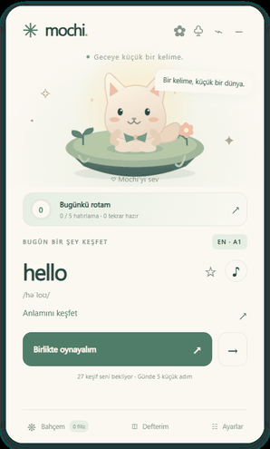
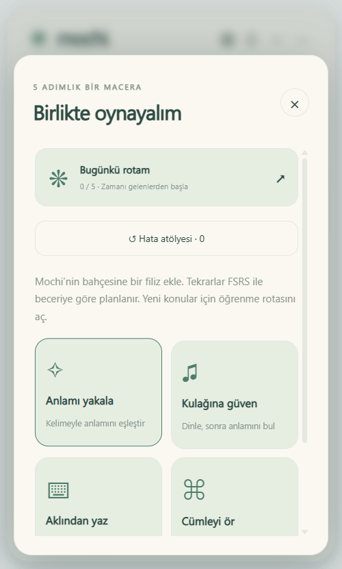
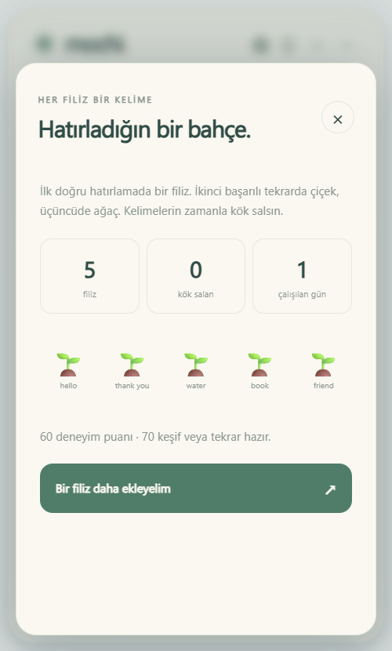
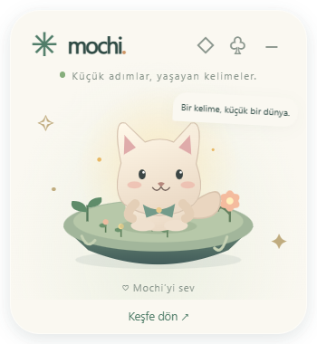
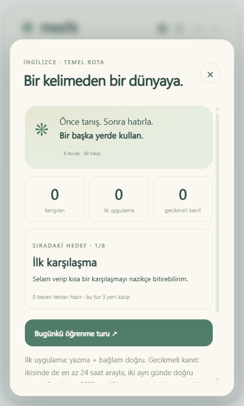
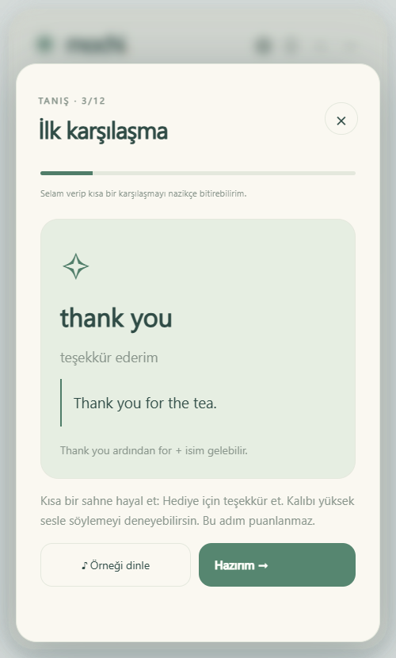
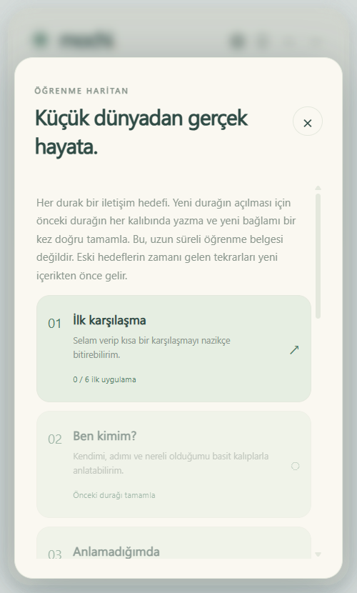
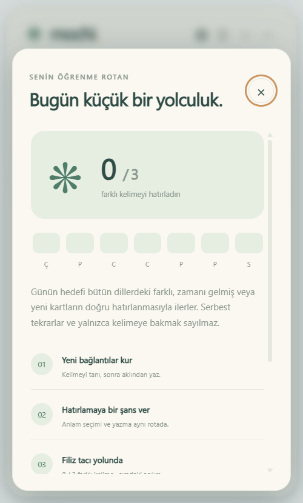
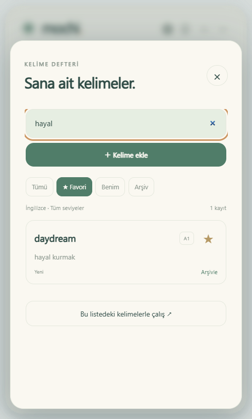
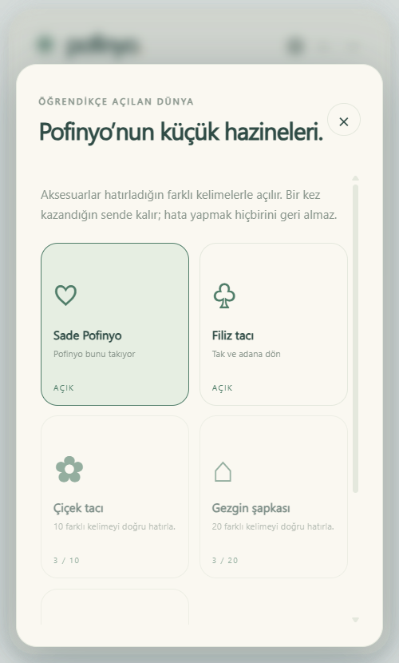

# mochi.
### Küçük adımlar, yaşayan kelimeler.

Masaüstünde yaşayan, seninle öğrenen küçük bir arkadaş. Mochi’ye dokun, bir kelime keşfet, mini bir oyun oyna. Hatırladığın kelimeler yüzen adanda filizlensin.

<p align="center"></p>

## Bir ders ekranından daha fazlası

- **Yaşayan bir karakter:** göz kırpma, nefes alma, kuyruk hareketi, pencere içindeki fareyi izleme, sevilince zıplama, hareketsiz kalınca uyuklama.
- **Dört küçük oyun:** anlam eşleştirme, dinlediğini anlama, hafızadan yazma ve kelimelerden cümle kurma. Oturum başına en fazla beş soru; süre baskısı yok.
- **Hafıza bahçesi:** ilk doğru hatırlama filiz, ikinci başarılı tekrar çiçek, üçüncü tekrar ağaç. Ekranda kelimeyi görmek veya karakteri sevmek öğrenme puanı vermez.
- **Aralıklı hatırlama:** başarılı tekrarlar 1 → 3 → 7 → 14 → 30 → 60 → 120 gün; yanlış cevap 1 dakika sonra yeniden hazır. Tarihi gelmiş tekrarlar yeni içerikten önce seçilir. İpucuyla tamamlanan cümleler ve gelecek tarihli serbest alıştırmalar tekrar tarihini ilerletmez.
- **Senin ritminde:** elle değiştirme veya 1 / 5 / 10 / 30 / 60 dakika; üç renk dünyası; isteğe bağlı yumuşak sesler; azaltılmış hareket; isteğe bağlı Windows başlangıcı.
- **Gerçek masaüstü widget’ı:** sürüklenebilir pencere, 400 × 660 öğrenme modu, 280 × 302 arkadaş modu, üstte tutma, sistem tepsisi ve pencere konumunu hatırlama.
- **Cihazında saklanır:** ilerleme ve ayarlar yerelde; JSON yedekleme ve geri yükleme. Hesap, abonelik veya API anahtarı gerekmez.

<table><tr><td></td><td></td><td></td></tr></table>


## 1.2 - öğretim sırası ve beceri bazında hafıza

**İngilizce seçip Bugünkü rotam düğmesine bas:** 8 iletişim durağı, 48 özgün temel kalıp, öğretim örnekleri, kısa dil bilgisi açıklamaları ve öğretimden farklı bağlam soruları. Önce öğren, sonra anlamı tanı, yardımsız yaz ve bir başka cümlede kullan. Diğer altı dilde mevcut serbest kart rotası sürer; ayrıntılı sıralı kurs henüz İngilizce içindir.

- Zamanı gelen tekrarlar önde; tur başına en fazla üç yeni hedef, birikmiş tekrar yükünde daha az yeni içerik.
- FSRS-6 her hedef ve beceri için ayrı çalışır. İpucu, erken tekrar ve aynı turdaki düzeltme takvimi veya XP'yi ilerletmez.
- İlk uygulama ile en az 24 saat arayla iki ayrı günde üretim ve bağlam başarısı ayrı sayılır. Bu dar ölçüm konuşma yeterliği veya CEFR sertifikası değildir.
- Eski kayıtlar ve kimlikler korunur; eski başarı serisinden yapay FSRS geçmişi veya gecikmeli kanıt üretilmez.
- Kısaltmalar açıkça listelenir; yazma kontrolü öğretilen biçimlerle sınırlıdır. Tam A1-C2 müfredatı, açık uçlu konuşma veya kişiye göre parametre optimizasyonu yoktur.

[Araştırma ve pedagojik kararlar](docs/EDUCATION-RESEARCH-2026-10-27.md) · [Sürüm doğrulaması](docs/VALIDATION-1.2.md) · [FSRS lisansı](ui/vendor/ts-fsrs.LICENSE)

<table><tr><td></td><td></td><td></td></tr></table>

## Kurulum

Windows için `Mochi-Setup-1.2.0.exe` kurulum paketini veya `Mochi-Portable-1.2.0.exe` taşınabilir sürümünü kullan. Pencerenin üstünden sürükleyerek yerini değiştir. `−` sistem tepsisine gizler; tepsi menüsündeki **Çıkış** uygulamayı tamamen kapatır. Otomatik başlangıç varsayılan olarak kapalıdır.

İngilizce başlangıç telaffuzları pakette WAV olarak bulunur. Diğer içeriklerde işletim sisteminin ilgili dildeki konuşma sesi kullanılır; uygun ses yüklü değilse dinleme çalışmayabilir. Mikrofonla konuşma değerlendirmesi yapılmaz.

## Dil içeriği ve sınırlar

Türkçe açıklamalı İngilizce, Almanca, Fransızca, İspanyolca, İtalyanca, Rusça ve Japonca için 229 eski içerik ve 48 yeni İngilizce temel hedefiyle toplam **277 içerik** bulunur. A1–C2 etiketleri yaklaşık zorluk göstergeleridir. Oyunlar kelime ve cümle içeriklerini kullanır; dilbilgisi satırları veri kümesinde korunur. Bu sürüm geniş kapsamlı bir dil kursu, CEFR sertifikası veya konuşma değerlendirme sistemi değildir. Gelişmiş seviyelerdeki havuzlar küçüktür. Tamamlanan içeriklerde serbest alıştırma yapılabilir.

Yazma oyunu büyük/küçük harf, fazla boşluk ve temel noktalama farklarını yok sayar; aksan farklarını korur. Alternatif doğru yazımlar için ayrı bir dil modeli kullanılmaz. Cümle kurma oyunu boşlukla ayrılan cümlelere açıktır; uygun örnek yoksa yazma oyununa geçer.

## Araştırmadan ürüne

[BongoCat](https://github.com/ayangweb/BongoCat), küçük ve tepkili bir karakterin masaüstüne nasıl kişilik katabildiğine ilham verdi. Mochi’nin karakteri özgün SVG çizimidir; BongoCat kodu veya Live2D modeli kopyalanmadı. Etkileşim uygulama penceresi içinde gerçekleşir; sistem genelinde tuş, fare, ekran veya mikrofon izlenmez.

[Kim & Webb’in aralıklı pratik meta-analizi](https://doi.org/10.1111/lang.12479) ve [Karpicke & Roediger’in yabancı dil kelimelerinde hatırlama çalışması](https://doi.org/10.1126/science.1152408), yalnızca tekrar göstermenin ötesinde aktif hatırlama gerektiren oyunları destekliyor. 1.2 sürümü, [ts-fsrs 5.4.2](https://github.com/open-spaced-repetition/ts-fsrs/tree/v5.4.2) üzerinden FSRS-6 kullanır. Hedef başına tanıma, yazma, bağlam, dinleme ve parçalı cümle becerilerinin takvimleri ayrıdır. Varsayılan model parametreleri kişisel geçmişe göre eğitilmiş değildir; uygulamaya özgü öğrenme etkisi henüz ölçülmedi. Ayrıntılar: [tasarım araştırması](docs/RESEARCH.md).

## Geliştirme

Node.js 24 ve npm:

```sh
npm ci
npm start
npm run check
npm run test:desktop
npm run test:studio
npm run test:education
npm run dist:win
```

`npm run check` bağımlılıksız model ve veri testlerini çalıştırır. Masaüstü testi gerçek Electron oturumunda dört oyunu, kayıt kalıcılığını, pencere modlarını ve güvenlik ayarlarını doğrular; ekran görüntülerini `docs/screenshots/` içine kaydeder. Windows dışında masaüstü testleri için grafik oturumu gerekir. macOS ve Linux paketleme tanımları bulunur; bu sürüm Windows’ta doğrulandı.

## Güvenlik ve kaynak kullanımı

Electron sandbox, context isolation, kapalı Node integration, dar IPC yüzeyi, izin engelleme ve CSP kullanılır. Dış ağ istekleri ve yeni pencereler engellenir. Animasyonlar CSS/SVG ile çalışır; fare güncellemeleri `requestAnimationFrame` ile sınırlandırılır. Gizlenen pencerede animasyonlar ve ses durur; tek bir 15 saniyelik zamanlayıcı keşif aralığını kontrol eder. Electron çalışma zamanı nedeniyle bellek maliyeti sıfır değildir. [Güncel doğrulama kaydı](docs/VALIDATION-1.2.md).

Eski ChalkLingo tahta arayüzü, fil karakteri ve yerel LLM köprüsü bu sürümde kaldırıldı. Önceki kaynaklar Git geçmişinde bulunabilir. MIT lisansı.

## 1.1 sürümünden gelen etkileşimler

[27 Ekim 2026 tarihli kaynaklı araştırma](docs/RESEARCH-2026-10-27.md), 10 yüksek yıldızlı ilgili projeyi ve kullanıcı geri bildirimlerini karşılaştırır. [Sayısal gözlem kaydı](docs/research-snapshot-2026-10-27.json) yıldızları, issue tepkilerini ve kaynak uç noktalarını içerir. Bu karşılaştırma bütün GitHub’ın kesin sıralaması veya temsilî bir kullanıcı anketi değildir.

- **Bugünkü rotam:** 3 / 5 / 10 farklı doğru hatırlama hedefi, son yedi gün ve anlam seçimiyle yazmayı birleştiren kısa bir tur. Zamanı geçmiş tekrarlar yeni kartlardan önce gelir.
- **Kelime defteri:** arama, favoriler, 500 adede kadar kişisel kelime/anlam/örnek, arşivleme ve geri alma. Listendeki kartlarla doğrudan çalışabilirsin; yedekler özel kayıtları da taşır.
- **Hata atölyesi:** son denemede zorlandığın kelimeler kapanıp açılınca kaybolmaz. İleri tarihli kartlarla serbest çalışma takvimi, XP’yi ve günlük hedefi ilerletmez; yardımsız doğru hatırlama aktif hata kaydını çözebilir.
- **Küçük hazineler:** 3 / 10 / 20 / 35 farklı başarılı kartla özgün yaprak, çiçek, gezgin ve yıldız aksesuarları açılır. Kazanılan aksesuarlar sonraki hatada kaybolmaz; sevmek öğrenme puanı kazandırmaz.
- **Daha akıcı etkileşim:** seçeneklerde 1-4, cevap sonrasında Enter, dinlemede R; cümle kelimelerini sürükleyebilir veya dokunarak taşıyabilirsin.
- **Masaüstüne uyum:** kısa ekranlarda pencere yüksekliği çalışma alanına sığar. Küçük arkadaş modundaki ◇ tıklamaları masaüstüne geçirir; tepsideki Mochi’ye tıklayarak etkileşimi geri açarsın. Yeni sakin boşta pozları mevcut zamanlayıcıyı kullanır.

<table><tr><td></td><td></td><td></td></tr></table>

1.0 ilerlemesi ve ayarları otomatik okunur; eski sürümün tutmadığı ayrıntılı günlük/hata olayları geriye dönük uydurulmaz. Yeni olay geçmişi son 2.000 kayıtla sınırlıdır. Aksesuar açılımları ve kartların ulaştığı en iyi seviye ayrıca korunur. Bu sürüm FSRS, mikrofonla değerlendirme veya otomatik çeviri eklemez. Kullanıcının eklediği içeriğin doğruluğu otomatik denetlenmez.

Yeni masaüstü akışlarını test etmek için `npm run test:studio` çalıştır. [1.1 doğrulama kaydı](docs/VALIDATION-1.1.md) kapsamı ve sınırlamaları açıklar. Kurulum dosyaları artık `Mochi-Setup-1.2.0.exe` ve `Mochi-Portable-1.2.0.exe` adlarını taşır.
