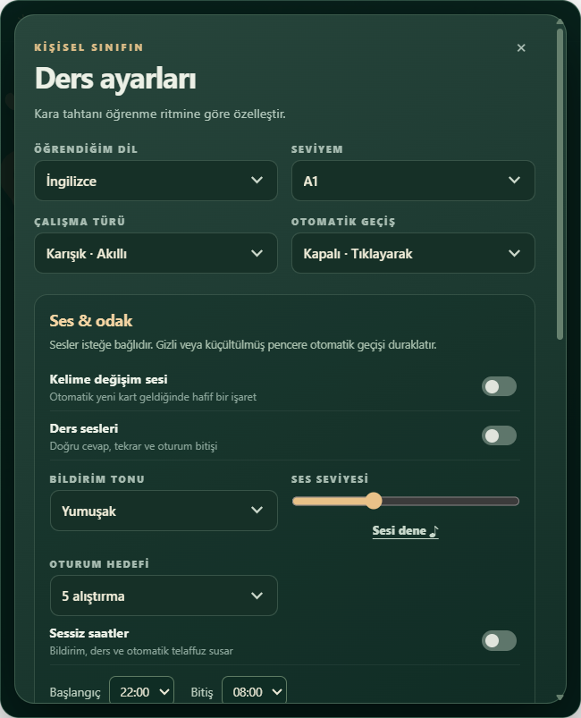
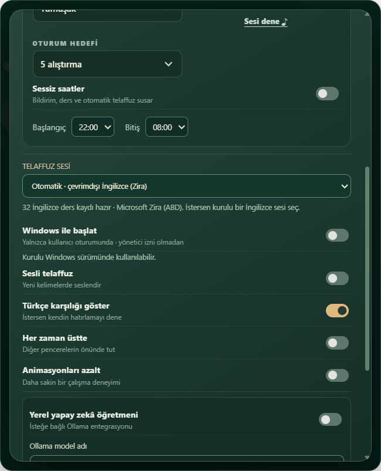
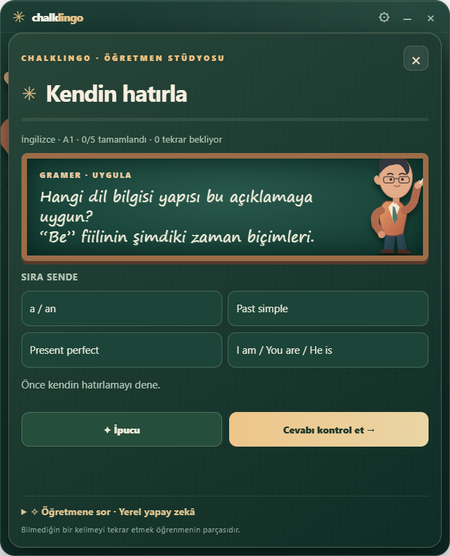

# CL · ChalkLingo

**v0.3.2 — Masaüstünde küçük, sesli bir dil öğrenme tahtası.**


CL, Yapışkan Notlar gibi küçük ve çerçevesiz bir Windows masaüstü widget’ıdır. Normal görünüm **360 × 340** mantıksal pikseldir; görev çubuğunda düğmesi yoktur. Yönetim için sistem tepsisinde CL simgesi bulunur. Windows Widget panosunun parçası değildir; arka planda bir masaüstü uygulaması çalışır.

## Güncel görünüm

<a href="docs/screenshots/widget-compact.png"></a>

Yalnızca ayarlar veya **Çalış** açıldığında panel yaklaşık **520 × 640** olur; kapatınca küçük hâline ve önceki konumuna döner. Windows ekran ölçeklendirmesi ve kenarlık yuvarlaması birkaç piksellik fark yaratabilir. Görüntüler gerçek Windows uygulamasından alınmıştır.

| Ders ve ritim ayarları | Telaffuz ve başlangıç | Aktif hatırlama |
| --- | --- | --- |
|  |  |  |

## Windows’a kurulum

1. **ChalkLingo Setup 0.3.2.exe** yükleyicisini çalıştır. Kurulum mevcut kullanıcı hesabına yapılır; yönetici yükseltmesi istenmez.
2. Masaüstünde ve Başlat menüsünde **CL** kısayolu oluşur. CL’yi aç.
3. İlk açılışta kullanıcı oturumuyla başlama etkinleştirilmeye çalışılır. Ayarlar → **Windows ile başlat** durumunu kontrol edebilir veya kapatabilirsin.

Varsayılan kurulum dizini kullanıcıya ait Programs klasörüdür. Paket imzasızdır; Windows uyarısı görülebilir. Defender, SmartScreen veya güvenlik duvarını kapatma. Kaldırmak için Windows → Yüklü uygulamalar → **ChalkLingo (CL)** yolunu kullan.

Taşınabilir EXE de üretilebilir; sabit kurulum ve açılışta başlama için yükleyici önerilir. Taşınabilir dosyanın yeri değişirse başlangıç yolu da yeniden ayarlanmalıdır. Paketler [GitHub Actions](https://github.com/snansrin/ChalkLingo/actions/workflows/ci.yml) başarılı Windows çalışmasının artifact bölümünde bulunur.

## Günlük kullanım

- Başlıktan sürükleyerek konumlandır; konum cihazda saklanır. **Her zaman üstte** isteğe bağlıdır, varsayılan kapalıdır.
- Tahtaya tıkla veya **Sonraki / Space** ile yeni karta geç.
- **Öğrendim / 2** kartı işaretler; **↶ / 1** tekrar sırasına alır.
- **Çalış** ile 5, 10 veya 15 alıştırmalık oturuma gir. Yanlış cevapta ipucu, ardından çözüm ve tekrar planı gösterilir.
- **♫ / R** telaffuz; **⚙ / sağ tık / S** ayarlar; **Escape** panelden dönüş.
- **− ve ×** uygulamayı kapatmak yerine tepsiye gizler. CL tepsi simgesine çift tıklayarak aç; gerçekten çıkmak için tepsi menüsündeki **Uygulamadan çık** seçeneğini kullan.

## Ritim, bildirim ve telaffuz

Otomatik geçiş kapalı olabilir veya **30 saniye, 1/2/5/10/15/30 dakika, 1/2 saat** seçilebilir. Bildirim sesi, ders sesleri ve otomatik telaffuz birbirinden bağımsız ve başlangıçta kapalıdır. Üç bildirim tonu, ses seviyesi ve sessiz saatler vardır. Sessiz saat başlangıcı/bitişi aynıysa gün boyu sessizdir. Elle ses denemesi kullanıcı isteğiyle çalışır.

Gizliyken, ayarlar veya ders açıkken otomatik kart akışı duraklar. Geri dönünce kaçırılan bildirimler üst üste çalmaz. Bildirimler uygulama içi sestir; Windows bildirim merkezine mesaj gönderilmez.

**İngilizce:** 32 mevcut İngilizce dersin özgün metni, Windows’un **Microsoft Zira Desktop (en-US)** sesiyle hazırlanmış çevrimdışı WAV kayıtlarıyla gelir. Otomatik ses seçiminde bu kayıtlar kullanılır; internet veya İngilizce ses paketi kurulumu gerekmez. Bu sentetik İngilizce sestir, insan stüdyo kaydı değildir. Kurulu başka bir İngilizce sesi ayrıca seçebilirsin.

Diğer dillerde hedef dile ait yerel sistem sesi gerekir. Uygun ses yoksa uyarı verilir; İngilizce veya başka dil Türkçe Tolga sesiyle okutulmaz. [Windows ses ekleme yönergesi](https://support.microsoft.com/en-us/accessibility/windows/narrator/appendix-a-supported-languages-and-voices).

## Eğitim kapsamı

7 dilde 212 başlangıç kartı: İngilizce, Almanca, Fransızca, İspanyolca, İtalyanca, Rusça ve Japonca. Kelime, cümle ve gramer türleri; Türkçe açıklamalar; yaklaşık A1–C2 etiketleri. Tam CEFR müfredatı veya resmî yeterlilik ölçümü değildir. Cevap eşleştirme deterministiktir; bazı doğru alternatifleri tanımayabilir. İlerleme yereldir ve JSON olarak yedeklenebilir.

İsteğe bağlı Ollama öğretmeni yalnızca etkinleştirip soru gönderdiğinde sabit 127.0.0.1:11434 adresine bağlanır. Model ayrıca kurulur ve ek RAM/CPU/GPU kullanabilir. Tek istek, zaman aşımı ve yanıt boyutu sınırı uygulanır. Model yanıtı doğruluk garantisi taşımaz.

## Güvenlik ve kaynak kullanımı

Hesap, reklam veya telemetri yoktur. Sandbox, context isolation, kapalı Node erişimi ve kısıtlı CSP kullanılır; IPC göndereni doğrulanır. Uzak gezinme ve yeni pencereler engellenir. Başlangıç kaydı yalnızca mevcut kullanıcıya aittir; servis kurulmaz, güvenlik ayarları değiştirilmez. Test profilleri Windows başlangıç kaydı oluşturmaz.

Tek zamanlayıcı kullanılır; gizli animasyonlar durur, sesler temizlenir, boşta ses motoru askıya alınır. **Sıfır kaynak tüketimi veya her cihazda donmama garantisi yoktur:** Electron birden fazla süreç ve RAM kullanır. Daha sakin kullanım için animasyonları azalt, uzun geçiş süresi seç ve yerel yapay zekâyı kapalı tut. Önceki sürümlere ait ölçümler [doğrulama raporunda](docs/VALIDATION.md); güncel ölçüm diye sunulmaz.

## Kaynaktan çalıştırma ve test

Node.js 24+ ve Git gerektirir.

```powershell
git clone https://github.com/snansrin/ChalkLingo.git
cd ChalkLingo
npm ci
npm run check
npm start
```

**npm run test:widget** küçük/geniş pencere ve tepsiyi, **npm run test:desktop** ders/ritim akışını kontrol eder. **npm run test:screenshots** gerçek görüntüleri yeniler. **npm run dist:win** yükleyici ve portable dosyalarını release/ klasörüne üretir. UI testleri görünür pencere açar; çalışırken pencereyle etkileşme. Ayrı .qa profili kullanılır. Birim/güvenlik testleri ses dili eşleştirmesini de kapsar.

MIT lisansı. DendroGeo’dan bağımsızdır.
