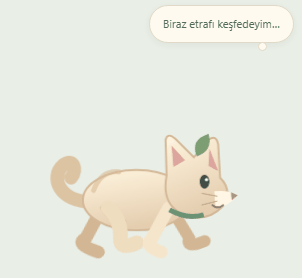
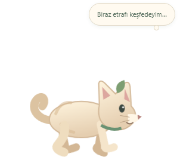
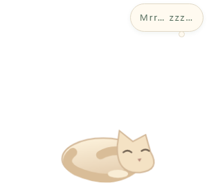

<p align="center"></p>
<h1 align="center">Pofinyo</h1>
<p align="center"><strong>Masaüstünde yaşayan küçük kedin. Dil öğrenirken sana eşlik eder.</strong></p>
<p align="center"></p>

## Masaüstünün kedisi

Pofinyo **dört ayağıyla yürür**, kısa koşular yapar, oturup etrafa bakar ve bir köşeye giderek **kıvrılıp uyur**. Uyandığında esneyip tekrar dolaşır. Platform, ada veya yastık üzerinde hareket etmez.

**Yalnız Windows masaüstü katmanında görünür: klasör ve simgelerin önünde, açık uygulamaların arkasında.** En üstte pencere modu kaldırılmıştır. Masaüstü bağlantısı hazır değilse kedi gizli kalır; uygulamaların üstüne çıkan bir pencereye dönüşmez.

<table><tr><td align="center"><br>Yürüyüş ve koşu</td><td align="center"><br>Kıvrılıp uyuma</td></tr></table>

- Yürüyüşte çapraz bacaklar, koşuda ön ve arka ayak çiftleri farklı ritimlerde hareket eder.
- Oturma, başını çevirip bakma, kuyruk hareketi, göz kırpma, uyku ve uyanış pozları vardır.
- Kısa düşünce baloncukları davranışına eşlik eder. Bunlar hazırlanmış cümlelerdir; mikrofon veya ekran izlenmez.
- Fare üzerine geldiğinde bekler; tıklayınca tepki verir. Yalnız kendi penceresindeki etkileşimleri alır.
- Hareket azaltma açıkken sakin kalır. Kilit ve uyku durumlarında gezinme durur.

## Kullanım ve kurulum

Windows x64 için **Pofinyo-Setup-2.0.0.exe** veya **Pofinyo-Portable-2.0.0.exe**. Paketler [Pofinyo geliştirme dalının başarılı GitHub Actions çalışmasındaki](https://github.com/snansrin/Pofinyo/actions/workflows/ci.yml?query=branch%3Afeat%2Fmochi-living-language) **Pofinyo-Windows** çıktısındadır.

1. Uygulamayı aç. Kedi masaüstünde yaşamaya başlar.
2. **Win + D** ile masaüstüne geçebilirsin. Başka uygulama açtığında kedi onun arkasında kalır.
3. Sistem tepsisindeki Pofinyo menüsünden **Masaüstü kedisi** seçeneğiyle açıp kapat.
4. **Öğrenme ekranını masaüstünde aç** ile eğitim araçlarına ulaş. Bu pencere de masaüstü katmanındadır.
5. Tamamen kapatmak için tepsi menüsündeki **Çıkış** seçeneğini kullan.

Windows ile başlatma ayarlardan isteğe bağlıdır. Eski Mochi/Pofinyo ilerlemesi, defteri ve ayarları korunur; depolama kimliği uyumluluk için sabittir.

## Nasıl öğretiyor?

**Tanış → anlamı hatırla → yardımsız yaz → başka bağlamda kullan → zamanı gelince tekrar et.**

- **İngilizce temel rotası:** 8 iletişim durağı, 48 özgün kalıp, açıklamalı örnekler ve farklı bağlam soruları.
- **FSRS-6:** tanıma, yazma, bağlam, dinleme ve parçalı cümle kurma kayıtları ayrıdır. Bir kelimeyi seçenekten tanımak, yazabildiğin anlamına gelmez.
- **Dört serbest oyun:** anlam eşleştirme, dinleme, aklından yazma ve cümle kurma; süre baskısı yoktur.
- **Kişisel defter:** arama, favoriler, kelime ve örnek ekleme, arşivleme ve geri alma.
- **İlerleme ve tekrar:** ilk uygulama ile sonraki günlerin kanıtı ayrıdır. İpuçları, erken tekrar ve aynı turdaki düzeltme takvimi ilerletmez. Kediyi sevmek veya izlemek XP kazandırmaz.

Türkçe açıklamalı İngilizce, Almanca, Fransızca, İspanyolca, İtalyanca, Rusça ve Japonca için **277 içerik satırı** bulunur: 234 kelime/cümle hedefi ve 43 dil bilgisi satırı. Ayrıntılı sıralı rota şu anda İngilizce temelidir; tam A1-C2 kursu veya CEFR sertifikası değildir. İleri seviye havuzlar küçüktür.

Başlangıç İngilizce sesleri pakettedir; diğer içeriklerde cihazın uygun dil sesi kullanılır. Konuşma veya telaffuz puanlama yapılmaz. Yazma kontrolü öğretilen biçimler ve listelenen alternatiflerle sınırlıdır.

## Gizlilik ve araştırma

Hesap, abonelik veya API anahtarı gerekmez. Eğitim kayıtları cihazındadır ve JSON olarak yedeklenebilir. Sistem genelinde klavye, fare, ekran veya mikrofon kaydı yapılmaz. Kedi ve öğrenme ekranının dış ağ erişimi kapalıdır.

[Pedagojik araştırma ve sınırlar](docs/EDUCATION-RESEARCH-2026-10-27.md) · [Masaüstü katmanı ve kedi doğrulaması](docs/DESKTOP-CAT-2.0.md). Genel FSRS parametreleri kişisel geçmişe göre eğitilmez; hedef hatırlama oranı bir model ayarıdır, başarı garantisi değildir. Bağımsız öğretmen incelemesi ve karşılaştırmalı öğrenme etkisi çalışması henüz yapılmadı.

## Geliştirme

Güncel Pofinyo kaynakları geliştirme dalındadır. Node.js 24 ve Git:

```sh
git clone --branch feat/mochi-living-language https://github.com/snansrin/Pofinyo.git Pofinyo
cd Pofinyo
npm ci
npm start
npm run check
npm run test:desktop
npm run test:studio
npm run test:education
npm run test:companion
npm run dist:win
```

Windows masaüstü bağlantısı Win32 **SetParent / WS_CHILD** ile Explorer masaüstü görünümüne yapılır; yalnızca üstte tutmayı kapatmakla yetinilmez. Kedi masaüstü simgelerinin kardeş penceresidir. Bağlantı kaybolduğunda gizlenir. Konumlandırma odak çalmaz ve kedi hiçbir zaman topmost yapılmaz. Win32 erişimi sabit sürümlü MIT lisanslı Koffi ile ana süreçte sınırlıdır; renderer'a genel yerel API verilmez.

Model testleri hareket sınırlarını, davranış geçişlerini ve eğitim motorunu kapsar. Gerçek Electron testleri masaüstü ebeveynini, simgelerin üzerindeki sırayı, topmost olmamasını, sabit boyutta hareketi ve eğitim akışlarını doğrular. Explorer olmayan test ortamında görünür overlay yerine gizli kalması kontrol edilir. Eski sürümün hareket modeli testleri tarihsel regresyon kapsamı olarak korunmuştur.

Masaüstü kedisi Windows Explorer gerektirir. macOS/Linux için masaüstü kedisi desteği yoktur. Diğer Windows kabukları ve tüm çoklu monitör/DPI kombinasyonları kapsamlı denenmedi. Electron'un bellek maliyeti vardır.

Pofinyo karakteri ve animasyonları özgün SVG/CSS çizimidir. MIT lisansı. [FSRS lisansı](ui/vendor/ts-fsrs.LICENSE) ve bağımlılıkların lisansları korunur.
